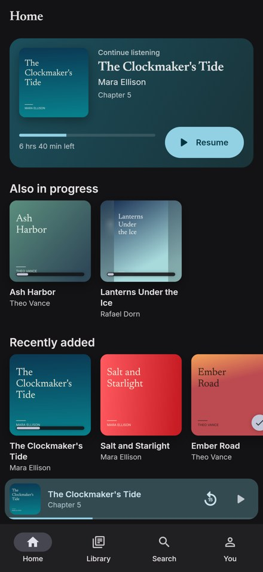
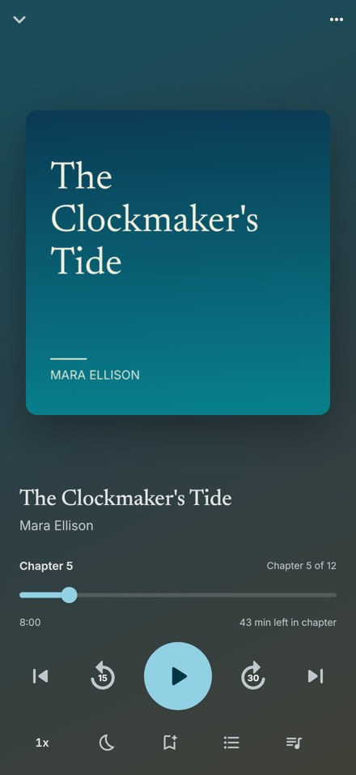
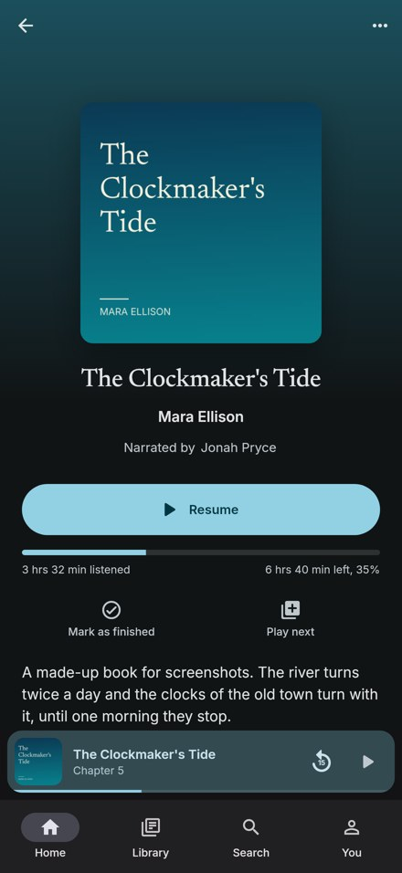
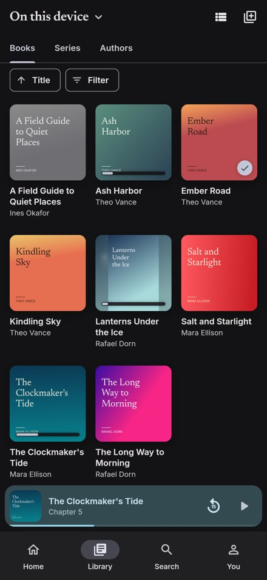

# Earloom

A free, open source [Audiobookshelf](https://www.audiobookshelf.org) client for Android and iOS, by Affluent Labs.

Earloom is for people who host their own Audiobookshelf server. Your server stays the home of your library, your progress and your stats. Earloom is the player: one design on both platforms, color drawn from each book's cover, full offline listening, and a place in the car, on the lock screen and on the home screen.

> **Status: release preparation.** The app is feature complete for 1.0 and heading to TestFlight and Google Play testing. The plan is in [`docs/plan/`](docs/plan/00-overview.md).

<p>
  
  
  
  
</p>

Screenshots use made-up demo books with generated covers.

## What it does

- Your Audiobookshelf server: home shelves, library, series, authors, collections, playlists, search, podcasts, progress synced both ways.
- Audiobook files on your phone, no server needed.
- Downloads for offline listening; progress syncs when you are back online.
- Chapters, bookmarks, per-book speed, a sleep timer that fades out, smart rewind.
- Android Auto, CarPlay, lock screen controls, home screen widgets, app shortcuts.
- Listening stats and a year in review.

Earloom is an independent app for Audiobookshelf servers. It is not affiliated with or endorsed by the Audiobookshelf project.

## Principles

- **Free.** No purchases, no ads, no locked features.
- **Private.** No analytics, no tracking, no crash reporting services. Your data moves only between your device and your own server.
- **Offline first.** Every screen works from what is already on the device. Being offline is a normal state, not an error.
- **Open.** GPL-3.0-or-later, developed in public.

## Building

You need the Flutter stable release named in [`CONTRIBUTING.md`](CONTRIBUTING.md).

```bash
git clone https://github.com/AffluentMods/earloom.git
cd earloom
tool/bootstrap.sh
flutter run --flavor foss   # Android; on iOS plain `flutter run`
```

`tool/bootstrap.sh` fetches packages and generates code (database and translations). On Windows, run it from Git Bash.

A local Audiobookshelf server with made-up sample books lives in [`tool/abs-dev/`](tool/abs-dev/seed/README.md).

## Contributing

See [`CONTRIBUTING.md`](CONTRIBUTING.md). Security reports: see [`SECURITY.md`](SECURITY.md).

## License

Copyright (c) 2026 Affluent Labs LLC.

Earloom is licensed under the GNU General Public License, version 3 or later ([`LICENSE`](LICENSE)), with an additional permission that allows distribution through app stores ([`LICENSE-EXCEPTION.md`](LICENSE-EXCEPTION.md)).

The bundled fonts, Inter and Newsreader, are licensed under the SIL Open Font License ([`assets/fonts/LICENSES/`](assets/fonts/LICENSES/)).
